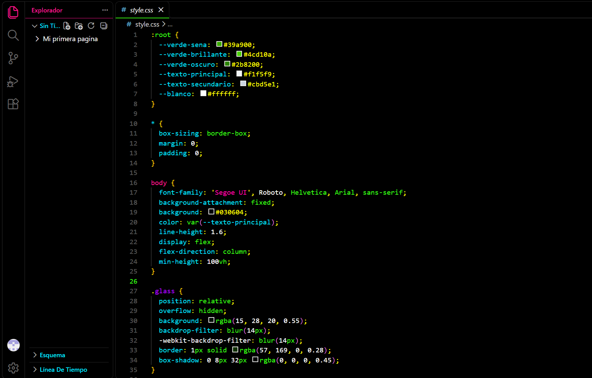

# MORBO DIVINO - Neon Dark

### A dark theme for Visual Studio Code.

A carefully crafted dark experience, designed with a distinctive visual identity.

---

---

## Installation

1. Open Visual Studio Code.
2. Go to Extensions.
3. Search for **Morbo Divino - Neon Dark**.
4. Click Install.

## Marketplace

[View Morbo Divino on Visual Studio Marketplace](https://marketplace.visualstudio.com/)
